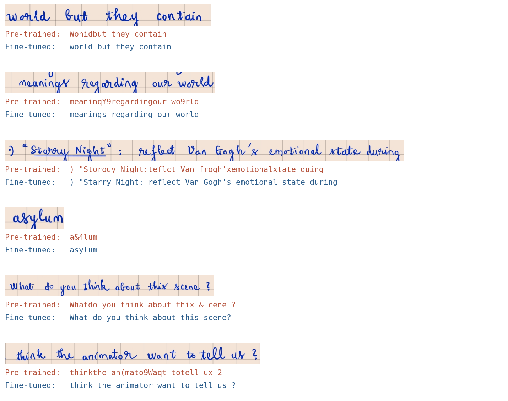

# Fine-tuning PaddleOCR to Read My Handwriting

PaddleOCR's lightweight English model struggles with my handwriting. I built a dataset of about 6,000 lines from my own notes and fine-tuned the model on it. On a page it had never seen, the share of characters it reads correctly rose from **82.6% to 96.7%**.



This project was advised by Professor [**Alexander Karpekov**](https://www.linkedin.com/in/karpekov/), who taught me **CS 3600: Introduction to Artificial Intelligence** at **Georgia Tech** in Summer 2025.

## Purpose

**OCR (optical character recognition)** turns a picture of text into text a computer can edit and search. General-purpose OCR models are trained mostly on printed text and many people's handwriting, so they can stumble on one person's particular style. Mine reads "asylum" as `a&4lum` and "Van Gogh's" as `Van frogh'x`.

The goal was to adapt an existing model to my handwriting, so I can turn my handwritten notes into text reliably.

## How it works

PaddleOCR reads a page in two stages:

1. **Detection** finds where the text is and draws a box around each line. *Example:* a box around "What do you think about this scene ?".
2. **Recognition** reads the text inside each box. *Example:* that box becomes the string `What do you think about this scene ?`.

This project fine-tunes only the recognition model, the [English ultra-lightweight PP-OCRv3 model](https://github.com/PaddlePaddle/PaddleOCR/blob/main/docs/version2.x/model/index.md). "Ultra-lightweight" means it is small and fast enough to run without a GPU.

### Step 1: Turn my notes into images

I gathered 35 PDFs of my own handwriting, including homework, lecture notes and planning documents. `pdf_to_image.py` saves each page as a JPEG, and 196 of those pages were used.

### Step 2: Cut each page into labeled lines

A recognition model learns from **labeled examples**: a picture of one line of text, paired with the correct text. *Example:* an image of "asylum" with the label `asylum`.

I made these with [PPOCRLabel](https://github.com/PFCCLab/PPOCRLabel), a labeling tool. It ran PaddleOCR 3.1 to detect each line, saved it as a separate image (a **crop**), and wrote a first guess of its text to `output_images/rec_gt.txt`. This produced **6,073 line crops**.

### Step 3: Clean up the labels with GPT-4o

PaddleOCR's first guesses contained errors, and a model trained on wrong labels learns those errors. `preprocessing.py` sends the labels to GPT-4o 100 lines at a time, with rules such as:

- keep upper and lower case as written
- leave abbreviations alone (*e.g.* `dep` stays `dep`, not "dependence")
- if unsure, leave the word as it is

The cleaned labels are saved in `dataset/data.txt`. They were not checked by hand, so some may still be wrong.

### Step 4: Split into training and test sets

`train_test_split.py` keeps the first 80% of lines as the **training set** (4,852 lines), which the model learns from. The last 20% become the **test set** (1,213 lines), held back to check the model on lines it never studied. The lines aren't shuffled, so the test set comes mostly from different notes than the training set.

### Step 5: Fine-tune the model

**Fine-tuning** means starting from a model that already reads English and training it a little more on new examples, instead of training from scratch. *Example:* it already knows what an "a" looks like in general; it only has to learn what *my* "a" looks like. This needs far less data and time than starting from zero.

Training settings, from `pretrained_model/en_PP-OCRv3_mobile_rec.yml`:

| Setting | Value | In plain words |
|---|---|---|
| Starting point | PP-OCRv3 English recognition weights | The model's existing knowledge |
| Epochs | 10 | The model studies all 4,852 training lines 10 times |
| Batch size | 128 | It looks at 128 lines, then adjusts itself |
| Optimizer | Adam, learning rate 0.001, cosine schedule, 5-epoch warm-up | How big each adjustment is: small at first, largest after 5 epochs, then shrinking |
| Data augmentation | Random distortions, and joining two crops into one image | Shows slightly altered copies so the model doesn't just memorize exact images |
| Input size | 48 × 320 pixels | Every crop is resized to this shape |
| Hardware | CPU only, about 5 hours | |

During training the model is scored by a **loss**: a number for how wrong its readings are, where lower is better. PP-OCRv3 combines two losses. **CTC loss** checks the characters read left to right, without knowing exactly where each one sits. **SAR loss** checks them one at a time, from a second branch of the model used only during training.

The trained model is then **exported** to `checkpoints/inference_model/`. This is a compact version for reading text, not for further training.

### Step 6: Test on an unseen page

`demo.py` runs the original and the fine-tuned model on `test_img.jpg`, a page of my handwriting that is in neither the training nor the test set. Both use the same detection step, so any difference comes from recognition alone.

## Result

| | Original model | Fine-tuned model |
|---|---|---|
| Characters read correctly on the unseen page | 82.6% | **96.7%** |
| Lines read exactly right (12 lines) | 2 | **8** |
| Training loss | 38.90 at the start | **3.87** at the end (90% lower) |
| Lines read exactly right in recent training batches | 10.9% | **57.4%** |

The page scores compare each detected line with what the page actually says, ignoring spaces. The remaining mistakes are small, such as `Iralism:` for "Irrealism :", `St.faul` for "St. Paul" and `Question8` for "Questions".

These page numbers come from **one page of 12 detected lines**, so treat them as an example, not a benchmark. The detection step also missed parts of the page, such as the "Burst of a Woman" line, and those parts aren't counted for either model. The 1,213-line test set was not scored during this run.

## Files

| File | What it does |
|---|---|
| `pdf_to_image.py` | Step 1: converts note PDFs to page images |
| `output_images/rec_gt.txt` | Step 2: PPOCRLabel's first-guess labels |
| `output_images/crop_img/` | Step 2: the 6,073 line crops |
| `preprocessing.py` | Step 3: cleans labels with GPT-4o, writes `dataset/data.txt` |
| `train_test_split.py` | Step 4: writes `dataset/train.txt` and `dataset/test.txt` |
| `pretrained_model/en_PP-OCRv3_mobile_rec.yml` | Step 5: training configuration |
| `ocr_training_log.txt` | Step 5: training log |
| `pretrained_model/inference_model/` | The original model, for comparison |
| `checkpoints/inference_model/` | The fine-tuned model |
| `demo.py`, `test_img.jpg` | Step 6: before/after test on an unseen page |

## Running it

Each stage used its own Python environment, because the tools need different PaddleOCR versions.

**Try the fine-tuned model** (`requirements_demo.txt`: PaddleOCR 2.10, PaddlePaddle 2.6):

```bash
pip install -r requirements_demo.txt
python demo.py
```

**Prepare data** (`requirements_prepare_data.txt`: PaddleOCR 3.1, PaddlePaddle 3.1, OpenAI). Put your PDFs in `documents/`, run `pdf_to_image.py`, label with PPOCRLabel, then set `OPENAI_API_KEY` in a `.env` file and run `preprocessing.py` and `train_test_split.py`.

**Fine-tune** (`requirements_training.txt`: PaddlePaddle 2.6.1). Clone [PaddleOCR](https://github.com/PaddlePaddle/PaddleOCR) and download the starting weights:

```bash
wget https://paddleocr.bj.bcebos.com/PP-OCRv3/english/en_PP-OCRv3_rec_train.tar
tar -xf en_PP-OCRv3_rec_train.tar
```

Update the absolute paths in the `.yml` file (`save_model_dir`, `data_dir`, `label_file_list`) to match your machine. Then, from the PaddleOCR folder:

```bash
python3 tools/train.py -c path/to/Fine-tuning_an_OCR/pretrained_model/en_PP-OCRv3_mobile_rec.yml \
  -o Global.pretrained_model=path/to/en_PP-OCRv3_rec_train/best_accuracy

python3 tools/export_model.py -c path/to/Fine-tuning_an_OCR/pretrained_model/en_PP-OCRv3_mobile_rec.yml \
  -o Global.pretrained_model=path/to/Fine-tuning_an_OCR/checkpoints/v3_en_mobile/latest \
     Global.save_inference_dir=path/to/Fine-tuning_an_OCR/checkpoints/inference_model
```

## References

- [PaddleOCR](https://github.com/PaddlePaddle/PaddleOCR)
- [PPOCRLabel](https://github.com/PFCCLab/PPOCRLabel)
- [Fine-Tuning PaddleOCR's Recognition Model for Dummies by a Dummy](https://anushsom.medium.com/finetuning-paddleocrs-recognition-model-for-dummies-by-a-dummy-89ac7d7edcf6), the tutorial that inspired this project
